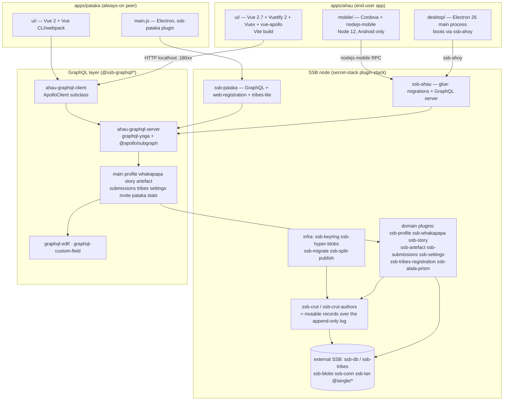
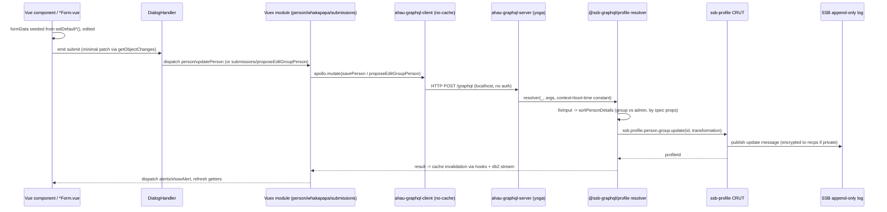
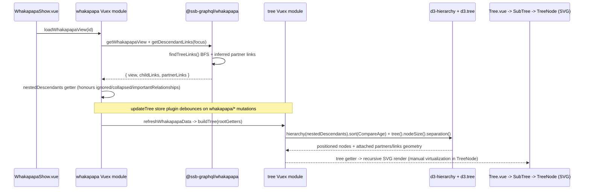
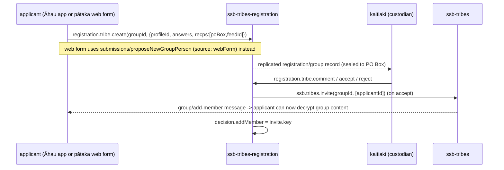

# Codebase Map

<!--toc:start-->

- [Codebase Map](#codebase-map)
  - [System Overview](#system-overview)
  - [Directory Structure](#directory-structure)
  - [Module Guide](#module-guide)
    - [`apps/ahau/desktop` — Electron main process](#appsahaudesktop-electron-main-process)
    - [`apps/ahau/mobile` — Cordova / nodejs-mobile](#appsahaumobile-cordova-nodejs-mobile)
    - [`apps/ahau/ui` — the frontend (~452k tokens, biggest area)](#appsahauui-the-frontend-452k-tokens-biggest-area)
    - [`apps/pataka` — always-online peer](#appspataka-always-online-peer)
    - [GraphQL layer](#graphql-layer)
    - [CRUT — the record substrate (`ssb-crut` + `ssb-crut-authors`)](#crut-the-record-substrate-ssb-crut-ssb-crut-authors)
    - [Domain packages](#domain-packages)
    - [Storage / infra packages](#storage-infra-packages)
  - [Data Flow](#data-flow)
    - [UI write (create/edit a person)](#ui-write-createedit-a-person)
    - [Whakapapa tree render](#whakapapa-tree-render)
    - [Membership registration (join a tribe)](#membership-registration-join-a-tribe)
  - [Conventions](#conventions)
  - [Gotchas](#gotchas)
  - [Navigation Guide](#navigation-guide)
  <!--toc:end-->

> Auto-generated by Cartographer. Last mapped: 2026-09-09.
> Āhau is a Scuttlebutt (SSB) peer-to-peer desktop/mobile app for recording Māori
> genealogy ("whakapapa"). This monorepo folds ~61 previously separate repos into
> `packages/` + `apps/` via `git subtree` (full history preserved), wired with npm
> workspaces. It is an explicit **proof-of-concept consolidation**: no CI, validation
> is local `npm test` per package. See `.claude/prds/` + `docs/adr/0001-*`.

---

## System Overview



Key facts:

- **No per-request auth.** The GraphQL "context" is computed once at node boot
  (`@ssb-graphql/main` `loadContext`) = `{ public:{feedId,profileId}, personal?:{groupId,profileId,settingsId} }`.
  Security boundary = the Electron/Cordova shell + CORS on localhost. Authorisation is
  entirely SSB-level: group membership, message decryptability, and `ssb-crut` `authors` sets.
- **Apollo cache is effectively disabled** — client forces `fetchPolicy:'no-cache'`, a
  `possibleTyes` typo in `ahau-graphql-client` stops `possibleTypes` reaching the cache,
  and nearly every query repeats `no-cache`. **Vuex is the real source of truth** in the UI.
- Every domain record is a **CRUT tangle**: an immutable root message + update messages
  carrying per-field transformations, reduced via `@tangle/*` merge strategies. Nothing is
  ever deleted — "tombstone" is just an update setting a reserved field.
- **`dev:ahau` currently crashes at launch** via `ssb-ahau → ssb-atala-prism → @atala/prism-wallet-sdk`.
  `dev:pataka` works end-to-end. (See Gotchas.)

---

## Directory Structure

```
ahau-monorepo/
├── package.json                 npm workspaces: packages/*, apps/*, apps/*/desktop, apps/*/ui
├── .nvmrc                        Node 20 (root); apps pin 18; mobile pins 12.19.0
├── .claude/{plans,prds}/        the consolidation plan + PRDs (proof-of-concept, no CI)
├── docs/adr/                    ADR-0001 = the consolidation decision
├── apps/
│   ├── ahau/                    the end-user whakapapa app
│   │   ├── package.json         orchestrator (concurrently dev:ui + dev:desktop)
│   │   ├── desktop/             Electron 26 main process (boots SSB via ssb-ahoy)
│   │   ├── mobile/              Cordova 10 + nodejs-mobile (Node 12, Android; iOS "paused")
│   │   │                        NOT a workspace member; own lockfile + bespoke noderify build
│   │   ├── ui/                  Vue 2.7 frontend (Vite 4) — ~452k tokens, the biggest area
│   │   ├── scripts/             guardrail scripts (secret scan, commit-lint, i18n checker) — written, not wired to CI
│   │   ├── plans/ + docs/       older single-repo-era docs (translation/Crowdin, web-registration)
│   └── pataka/                  always-online replication peer + optional web-registration server
│       ├── main.js              Electron entry (this app's root IS the Electron app)
│       └── ui/                  still Vue CLI/webpack (NOT migrated to Vite); 0 tests
├── packages/
│   ├── ahau-env/               zero-dep: SSB caps + full port map per env (dev/staging/prod)
│   ├── ahau-graphql-server/    graphql-yoga + @apollo/subgraph — stitches schema modules
│   ├── ahau-graphql-client/    ApolloClient subclass (upload link, no auth, no subscriptions)
│   ├── ssb-crut/               CRUT base: mutable records over the append-only log
│   ├── ssb-crut-authors/       CRUT + `authors` set + authorship validation rules
│   ├── ssb-profile/            person/community/pataka profile records (built on CRUT)
│   ├── ssb-whakapapa/          ALL relationship-edge records (parent-child, partner,
│   │                           story↔profile, story↔artefact, story↔story) + whakapapa/view
│   ├── ssb-story/              story + collection records + collection↔story link
│   ├── ssb-submissions/        propose → approve/reject → execute workflow over any CRUT
│   ├── ssb-ahau/               app glue: runs migrations, builds the federated GraphQL server
│   ├── ssb-pataka/             pataka: GraphQL server + tribes-lite (boxer only) + web-registration
│   ├── ssb-atala-prism/        DID / verifiable-credential integration (Hyperledger Identus)
│   ├── ssb-tribes-registration/ apply-to-join-a-group flow (registration/group record)
│   ├── ssb-split-publish/      work around SSB's 8 KiB message-size limit
│   ├── ssb-keyring/            on-disk box2/envelope keystore (sync reads, async writes)
│   ├── ssb-hyper-blobs/        hypercore blob storage/serving + drive replication + pruning
│   ├── ssb-artefact/           SSB record type for a media artefact (points at a blob)
│   ├── artefact-store/         SSB-agnostic hyperdrive blob store + per-file stream encryption
│   ├── artefact-server/        Koa HTTP wrapper over one artefact-store (+ CLI)
│   ├── ssb-settings/           per-identity settings record (e.g. keyBackedUp) + feed↔settings link
│   ├── ssb-migrate/            record + run outstanding DB migrations in order
│   ├── graphql-edtf/           Date / EdtfDate / EdtfInterval scalars (fuzzy dates)
│   ├── graphql-custom-field/   polymorphic CustomField scalar
│   ├── graphql-stats/          host telemetry (CPU/mem/disk/net) — not SSB
│   └── ssb-graphql-{main,profile,whakapapa,story,artefact,submissions,tribes,
│       settings,invite,pataka}/ the GraphQL schema modules (one per domain)
```

---

## Module Guide

### `apps/ahau/desktop` — Electron main process

**Purpose**: boot the SSB node + open the app window. **Entry**: `desktop/main.js` (dev) →
esbuild-bundled to `main.bundle.js` (prod, via `bundle.mjs`).

Boot sequence (shared with `apps/pataka/main.js`):

1. Monkey-patch `sodium-native.sodium_malloc/free` (Electron >20.3.8 v8 memory-cage bug).
2. `ahau-env()` → env + ports from `NODE_ENV`.
3. `ssb.config()` merges a hardcoded `core` config with a persisted JSON file (+ random `mixpanelId`).
4. `checkAhauRunning()` — open a LevelDB lock at `<path>/tribes/keystore`; lock error ⇒ another instance ⇒ quit.
5. `start()` → **`ssb-ahoy`** builds the secret-stack SSB server from `ssb.plugins.js` and opens the `BrowserWindow`.
6. The **`ssb-ahau` plugin** (not `main.js`) runs migrations then starts the GraphQL server on `config.graphql.port` (dev `18067`).
7. Renderer polls `whoami` until it answers, then mounts Vue.
8. ahau only: `startAtalaPrism(ssb)` — **the current `dev:ahau` crash site**.

**Key files**: `main.js`, `ssb.config.js`, `ssb.plugins.js`, `atala-prism.js`, `bundle.mjs`,
`build/electron-builder.config.js`, `patches/` (7 patch-package patches — notably `ssb-friends`
patched to hard-throw if `sbot.db` exists, locking the app to legacy `ssb-db`).

### `apps/ahau/mobile` — Cordova / nodejs-mobile

Not a workspace member. Node **12.19.0**. `src/nodejs-project/` is a transpiled-for-Node-12
mirror of the desktop SSB stack; `index.js` builds `SecretStack(...)` directly (no Electron/ahoy)
and bridges to the webview over `cordova.channel` RPC. `scripts/run.sh` drives a bespoke build:
Babelify allowlist → `noderify` with native-module `--replace` swaps, switching `nvm use` between
Node 18 (ui) and Node 12 (backend).

### `apps/ahau/ui` — the frontend (~452k tokens, biggest area)

**Stack**: Vue 2.7 SFCs, Vuetify 2 (dark-only), Vuex 3, Vue Router 3 (history mode),
vue-apollo 3, vue-i18n 8, d3 7. **Build**: Vite 4 (`vue.config.js` is vestigial). Targets the
Electron 18 webview.

**Bootstrap** (`src/main.js`): `VuexRouterSync.sync` → global plugins → poll the local GraphQL
`whoami` query every 500 ms → `new Vue({router, store, apolloProvider, vuetify, i18n})`. Theme
applied via `initializeThemeService({vuetify})` before mount.

| Sub-area                   | What it holds                                                                                                                                                                                                                                                                                                                                                                                                                                                                                                                                                                                                                   |
| -------------------------- | ------------------------------------------------------------------------------------------------------------------------------------------------------------------------------------------------------------------------------------------------------------------------------------------------------------------------------------------------------------------------------------------------------------------------------------------------------------------------------------------------------------------------------------------------------------------------------------------------------------------------------- |
| `src/store/**`             | **Vuex is the source of truth.** One root module (un-namespaced: `whoami`, `currentAccess`, `isKaitiaki`) + ~21 namespaced modules. `whakapapa/index.mjs` (906 lines) is the graph _model_; `tree/index.mjs` turns it into a positioned d3 layout; `table/index.js` is the tabular view of the same graph. `person/index.js` is a profile cache with a width-10 pull-stream query queue. `submissions` + `notifications` = kaitiaki moderation. `.mjs` modules are the newer/tested ones (Tape). An `updateTree` store plugin debounces d3 relayout on `whakapapa/*` + `person/setPerson` mutations while on a whakapapa route. |
| `src/components/dialog/**` | `DialogContainer.vue` (shared shell) + `DialogHandler.vue` (global dispatcher, mounted in App.vue + WhakapapaShow.vue — carries most whakapapa create/link/submit logic). Convention: `<DialogContainer>` + a `*Form.vue` bound `:x.sync="formData"`, seeded from `setDefault*()`, diffed on submit via `getObjectChanges` → emit minimal patch.                                                                                                                                                                                                                                                                                |
| `src/components/** (rest)` | `tree/` (SVG hand-rendered from d3-hierarchy layout; `TreeNode` does manual virtualization for big trees), `table/` (hand-built SVG "spreadsheet"), `profile/` (`ProfileForm.vue` ~1050 lines drives default + per-tribe custom fields), `menu/`, `community/`, `story/`, `submission/`, `settings/`, `wallet/` (verifiable credentials), `csvImport/`, `archive/` (stories/collections UI).                                                                                                                                                                                                                                    |
| `src/views/**`             | 7 route-level components. Real routes are `/tribe/:tribeId/(community\|person)/:profileId/...` with `ProfileShow.vue` as the layout shell; route `name` strings are string-parsed everywhere to derive `person` vs `community` context (fragile, TODO'd for a REST refactor).                                                                                                                                                                                                                                                                                                                                                   |
| `src/lib/**`               | Framework-agnostic `.mjs` helpers: GraphQL operation/fragment builders (`person-helpers`, `story-helpers`, …) + pure utils (EDTF dates, CSV, diffing, theming, avatars, SVG tree geometry). Peer to `src/store/modules/*/apollo-helpers.*`; they import each other's fragments freely. `PERMITTED_*_ATTRS` arrays double as read-shape and write-whitelist.                                                                                                                                                                                                                                                                     |
| `src/translations/**`      | `vue-i18n` v8, 6 static locales (`en_NZ` default+fallback, `en_US`, `es_ES`, `mi_NZ`, `nl_NL`, `pt_BR`), each 45 per-feature JSON files aggregated by `<locale>/index.mjs`. No lazy loading. Crowdin round-trips `en_NZ` → `mi`.                                                                                                                                                                                                                                                                                                                                                                                                |
| `e2e/`                     | Playwright (chromium only), **no `webServer`** — the full Electron+SSB backend must run first (`npm run dev:ahau`), then `npm run test:e2e`.                                                                                                                                                                                                                                                                                                                                                                                                                                                                                    |

### `apps/pataka` — always-online peer

Forked from ahau. Reduced plugin set + `ssb-pataka`; **no** tribes, tribes-registration,
ssb-ahau, atala-prism. `ssb-pataka` owns its GraphQL server (dev `18068`). UI is still Vue
CLI/webpack (not migrated) with 0 tests. Can seal (encrypt) group content but **never
decrypt** it — replicates it as backup. `ssb-pataka` also bundles four sub-plugins: the
GraphQL HTTP server, `tribes-lite` (boxer only, no unboxer), `web-registration` (express
static site + HTTPS reverse proxy, production `NODE_ENV` only, LetsEncrypt certs), and
verbose logging.

### GraphQL layer

**`ahau-graphql-server`** (1 file): `{context, schemas, port, allowedOrigins}` →
`express` + `graphqlUploadExpress` + `createYoga({schema: buildSubgraphSchema(schemas)})`.
Context factory ignores the request (returns the boot-time constant). CORS is `NODE_ENV`-aware.

**Schema module shape**: `(ssb, externalGetters?) => { typeDefs, resolvers, gettersWithCache? }`.
`@ssb-graphql/main` also exports `loadContext`. `typeDefs` use `extend type Query/Mutation` +
Federation `@key` directives (subgraph build is used for its merge semantics; no gateway runs).

**`gettersWithCache`** is the cross-module wiring: a module publishes its cached record
loaders (e.g. `profile.getProfile`) so others resolve through the same LRU + invalidation.
The **real composition site is `packages/ssb-ahau/src/graphql/index.js`** (and
`ssb-pataka/plugins/graphql.js`), NOT any `@ssb-graphql/*` package.

| Module                 | Wraps                                                  | Owns / adds                                                                                                                                                                                                                                                                |
| ---------------------- | ------------------------------------------------------ | -------------------------------------------------------------------------------------------------------------------------------------------------------------------------------------------------------------------------------------------------------------------------- |
| `main`                 | blobs, settings                                        | root `Query`/`Mutation`/`Subscription`(disabled), scalars (`Date`/`Edtf*`/`Upload`), `Blob`, `whoami`, `loadContext`, `uploadFile` (routes to ssb-blobs or hyper-blobs)                                                                                                    |
| `profile`              | `ssb-profile`                                          | `Person`/`Community`/`Pataka`, tribes/subtribes, `savePerson`/`deletePerson`; **two `hashlru` caches** with hook + db2-stream invalidation; `gettersWithCache = {getProfile, getTiaki}`. `post-save-person.js` encodes the group-vs-admin-profile permission decision tree |
| `whakapapa`            | `ssb-whakapapa` (+ profile/story/artefact getters)     | `WhakapapaView`, graph-walk queries (`findTreeLinks`, `loadFamilyOfPerson`), stitches `Person`/`Story`/`Artefact` link fields; two overlapping LRU link caches; synthesises `inferred` partner links from shared birth children                                            |
| `story`                | `ssb-story`                                            | `Story`/`Collection`, collection↔story links; `StoryFilter.type` is mandatory (no index without it)                                                                                                                                                                        |
| `artefact`             | `ssb-artefact`                                         | `Photo`/`Video`/`Audio`/`Document`; `gettersWithCache = {getArtefact}`                                                                                                                                                                                                     |
| `submissions`          | `ssb-submissions`                                      | propose/approve GraphQL; always targets `profile/person/admin`; no cache of its own; hard-depends on profile + whakapapa types being in the stitched schema                                                                                                                |
| `tribes`               | `ssb-tribes`, `ssb-tribes-registration`, `ssb-profile` | groups/subgroups, `GroupApplication` flow; only group-B module that reads GraphQL `context`                                                                                                                                                                                |
| `settings`             | `ssb-settings`                                         | `Settings` on `PersonalIdentity`                                                                                                                                                                                                                                           |
| `invite`               | `ssb-invite`, db2                                      | invite create/accept, block/unblock pataka (Mutation-only)                                                                                                                                                                                                                 |
| `pataka`               | `ssb-friends`, db2 counts                              | `invitedPeople`, `dataSummary` (story/artefact counts hard-coded 0)                                                                                                                                                                                                        |
| `graphql-edtf`         | `edtf` lib                                             | `Date` / `EdtfDate` / `EdtfInterval` scalars                                                                                                                                                                                                                               |
| `graphql-custom-field` | —                                                      | polymorphic `CustomField` scalar (String / [String] / Int / Float / Boolean / blob / null)                                                                                                                                                                                 |
| `graphql-stats`        | `systeminformation`, `public-ip`                       | host telemetry (not SSB)                                                                                                                                                                                                                                                   |

Local schema modules defined inside `ssb-ahau/src/graphql/`: `author` (patches
`authors`/`canEdit`/`tiaki`/`originalAuthor` onto every record type via sequence-interval
authorship checks), `group-init` (`initGroup` = tribe + admin subgroup + po-box + community
profiles), `backup` (**returns the node secret key** — localhost-only guard), `stats`
(`deleteAhau` rimrafs the whole DB).

### CRUT — the record substrate (`ssb-crut` + `ssb-crut-authors`)

A record = a **tangle**: root message + update messages, each referencing prior tips and
carrying per-field _transformations_ (not snapshots). `read()` fetches root + updates,
topo-sorts, and reduces via `@tangle/*` strategies (`Overwrite` = last-writer-wins,
`SimpleSet` = `{add,remove}`, `OverwriteFields` = keyed map). Concurrent offline edits →
multiple tips → `conflictFields` + per-tip `states[]`; `lib/force.js` auto-resolves by
picking the most-recently-edited branch (only sound for `Overwrite` fields).

A **`spec`** = `{ type, props: {field: <@tangle strategy>}, staticProps, tangle, hooks:
{isRoot, isUpdate}, isValidNextStep?, getTransformation? }`. `props` drive both the
JSON-schema validator and the reducer. `recps` (private recipients) is root-only and
immutable; if present the whole tangle is encrypted (via `ssb-tribes`/box2).

`ssb-crut-authors` adds an `authors` `SimpleSet` prop + rules: ≥1 author on create, updaters
must be active on every extended tip, `'*'` = anyone. Authors are feedId → `[{start,end}]`
sequence intervals.

**The CRUT spec is the source of truth** — there is no codegen. The GraphQL layer reads
`Object.keys(spec.person.group.props)` at runtime to split input across group/admin records.
Contract: spec prop names == GraphQL input field names; drift is caught only by tests.

### Domain packages

- **`ssb-profile`** — exposes `ssb.profile.{person.{source,group,admin,public}, community.{group,public}, pataka.public}`, each a `CrutAuthors` instance, plus `link/*` records (feed↔profile, group↔profile) and a db2 leveldb name-search index. `person.group` carries member-visible fields; private contact fields + non-member custom fields live on a linked `person/admin` profile in an admin sub-tribe with a PO Box — `adminProfile` stitches them back.
- **`ssb-whakapapa`** — owns _all_ relationship-edge records (not just genealogy): `link/profile-profile/{child,partner}`, `link/story-profile/{creator,contributor,mention}`, `link/story-artefact`, `link/story-story`, dispatched by type string in `lib/crut-by-type.js`. Also the `whakapapa/view` record (saved family-graph perspective: focus, mode, ignoredProfiles, importantRelationships). Only per-node lookups (`getLinksOfType`); the graph BFS lives in `@ssb-graphql/whakapapa`.
- **`ssb-story`** — `story/*` (EDTF-validated metadata), `collection/*`, `link/collection-story`. Spec _factories_ (`Spec(type)`) serve many subtypes. Story-link methods exist in-process but are **not in the muxrpc manifest**.
- **`ssb-submissions`** — `registerHandler(crut)` registers a record CRUT; `proposeNew/Edit/Tombstone` validate proposed details against the target spec; `executeAndApprove` writes the real record then approves, resolving one-level dependency links. **Self-approval is not blocked** (TODO).
- **`ssb-ahau`** — plugin `ahau`, manifest = just `onReady`. On boot: auto-connect LAN peers, `auto-link-profiles`, run `ssb-migrate` migrations (skipped under `NODE_ENV` test/development), start the federated GraphQL server.
- **`ssb-atala-prism`** — DID / verifiable-credential support via `@atala/prism-wallet-sdk` (Hyperledger Identus). Three layers: low-level muxrpc, an SSB-message-driven state machine (`auto-respond.js`) advancing `atalaPrism/auto-{issuance,presentation}` CRUT records, and a GraphQL schema. Holder runs a local SDK edge agent (encrypted LevelDB wallet, hard-coded key, non-persisted seed); kaitiaki run _remote_ Issuer/Verifier HTTP nodes (URL + APIKEY per tribeId in config). Needs `.npmrc` GitHub token for `@input-output-hk`; tests are live integration tests; the SDK is acknowledged flaky.
- **`ssb-tribes-registration`** — `registration.tribe.{create,get,comment,accept,reject,update,list}` over a `registration/group` CRUT. `accept()` calls `ssb.tribes.invite()` to publish the real `group/add-member` message. Sealed to `[poBoxId, feedId]`.
- **`ssb-split-publish`** — factory (not a plugin): on the 8192-byte oversize error, call a caller-supplied `splitter`, publish the first (most-likely-to-fail) chunk, run an `afterPublish` hook, recurse. Partial-publish risk if a later chunk fails.

### Storage / infra packages

Blob stack — four layers, bytes flow bottom-up, SSB records reference the bytes:

| Package           | Layer                                                                                                             | SSB? | HTTP?     | Bytes?        |
| ----------------- | ----------------------------------------------------------------------------------------------------------------- | ---- | --------- | ------------- |
| `artefact-store`  | hyperdrive store + per-file XSalsa20 stream encryption (**no MAC**) + hyperswarm DHT                              | no   | no        | yes           |
| `artefact-server` | Koa HTTP wrapper over one store (`POST /blob`, `GET .../blob/:id` w/ Range) + CLI                                 | no   | yes       | no            |
| `ssb-hyper-blobs` | secret-stack plugin: embeds an `artefact-server`, bridges drive replication into the SSB peer graph, prune policy | yes  | starts it | no            |
| `ssb-artefact`    | secret-stack plugin: the SSB CRUT record that _references_ a blob (`ssb` or `hyper` variant)                      | yes  | no        | no (metadata) |

Two independent crypto systems: blob confidentiality = a per-file random 32-byte `readKey`
carried inside the (optionally box2-encrypted) SSB record; SSB message encryption keys live
in **`ssb-keyring`** (LevelDB, sync in-memory read caches, async writes; key sources: auto
`self` key, external `signing`/`group`/`poBox` keys, DH-derived `dm` keys).

Pruning (`ssb-hyper-blobs`) only ever evicts _other peers'_ replicated blobs, oldest-access
first, when summed remote drive size exceeds `maxRemoteSize` (default 5 GB), and only if
`config.hyperBlobs.autoPrune` is explicitly enabled.

**`ahau-env`** (zero-dep) is the single source of truth for SSB `caps` (network isolation)
and the port map: main `80xx`, serveBlobs `280xx`, hyperBlobs `380xx`, graphql `180xx`
(xx = 67/68 dev, 77/78 staging, 87/88 prod; second of each pair = pataka). **No `test`
env** — consumers pass `'development'` for tests.

**`ssb-migrate`** records completed migrations in `<ssb.config.path>/migration.json`,
discovers `${unixMs}-desc.js` files, runs outstanding `up(ssb, {}, cb)` sequentially.
Ordering is only truly sorted in the bundled `opts.migrations` path (used by `ssb-ahau`).

---

## Data Flow

### UI write (create/edit a person)



### Whakapapa tree render



### Membership registration (join a tribe)



---

## Conventions

- **Resolver style** (all `@ssb-graphql/*`): factory `Thing(ssb, deps) => nodeCallbackFn`,
  `promisify`'d in an aggregator, exposed as `(_, args, ctx) => promiseFn(args)`. Heavy
  `pull-stream` + `pull-paramap` (concurrency 4–6). **No pagination anywhere** — list
  resolvers stream the whole log and `slowEqual('...tangles.<x>.root', null)` for roots.
- **Tombstone date coercion**: GraphQL `Int` is 32-bit, so every `fixInput`/`buildTransformation`
  does `tombstone.date = Number(value.date)` (comment copy-pasted in ~6 files).
- **Author-set inputs**: `{ add: [String], remove: [String] }`; `authors: { add: ['*'] }` = any group member may edit.
- **Errors**: raw ssb errors re-wrapped as `new GraphQLError(err)` (Error object, not string).
  "Can't decrypt / not admin" errors are **deliberately swallowed to `null`** so non-kaitiaki
  members just don't see admin data. Single-record hydration failures in lists are logged +
  `filter(Boolean)`'d.
- **UI GraphQL**: `graphql-tag` template literals only, no codegen, no `.graphql` files.
  Fragments composed by string interpolation. `PERMITTED_*_ATTRS` arrays double as read-shape
  and `lodash.pick` write-whitelist. Nearly every operation is `fetchPolicy:'no-cache'`.
- **Vuex modules**: `(apollo) => ({ namespaced:true, ... })` factories; `.mjs` = newer/tested
  (Tape beside them); `dialog` is the only non-namespaced feature module.
- **Dates**: EDTF strings (`edtf` npm) in `"lower/upper"` interval form (`aliveInterval`,
  `timeInterval`); `X` = unknown digit; display formatting is hand-rolled + i18n month keys.
- **Tests**: `tape` + `tap-arc` everywhere. Every `@ssb-graphql/*` + domain package has a
  `test/test-bot.js` spinning a real `scuttle-testbot` ssb-db2 stack served through
  `ahau-graphql-server`, exercised over HTTP via `ahau-graphql-client`. `npm test` also greps
  for `test.only` and fails if found.
- **Terminology**: _tribe_ = SSB private group/community; _kaitiaki_ = admin/guardian/custodian;
  _pātaka_ = always-online replication peer ("storehouse"); _whakapapa view_ = a saved family-tree
  record; _focus_ = the root person of a tree; _whāngai_ = customary adoption (dashed links).
- **Naming**: package directories are hyphenated even when the npm name is scoped
  (`packages/ssb-graphql-main` ⇒ `@ssb-graphql/main`).

---

## Gotchas

**Environment / build**

1. **`npm run dev:ahau` crashes at startup** — `ssb-ahau → ssb-atala-prism → @atala/prism-wallet-sdk`.
   Pre-existing; `dev:pataka` works end-to-end.
2. **Plain `npm install` aborts** monorepo-wide (workspace hoisting breaks postinstall relative
   paths). Use `npm install --ignore-scripts`, then replay scripts manually, then
   `node node_modules/electron/install.js`. (README documents the full procedure.)
3. **Node version split**: root `.nvmrc` = 20; `apps/ahau/{root,ui,desktop}` `engines` = `>=18 <19`;
   `apps/ahau/mobile` + `mobile/src/nodejs-project` = exactly 12.19.0. `AGENTS.md`/`CLAUDE.md` in
   `apps/ahau` still say Node 18.
4. **`ssb-ahau: ^16.4.1`** stale pin in `apps/ahau/desktop/package.json` vs local `17.0.0` ⇒
   desktop silently uses a nested registry copy (`16.5.1`) for its most important dependency.
5. **`ssb-friends` is patched to `throw` if `sbot.db` exists** — hard-locks both apps to legacy
   `ssb-db`, not `ssb-db2` (except `ssb-ahau`'s own internal db2 operator imports).
6. **No CI.** `apps/ahau/scripts/ci-*.sh` are written (GitLab + GitHub env aware) but wired to
   nothing. `apps/ahau/ui/.eslintrc.js` and `apps/pataka/ui/.eslintrc.js` have date-based
   rule-severity time-bombs that are now active.
7. **`apps/pataka/ui` is still Vue CLI/webpack** (not Vite) and has 0 tests despite a `test` script.
   `apps/pataka` misc: `dist` script typo (`build:backaned`), `update-package.js` dangling `if`,
   `build/build-icons.js` needs the un-migrated `ahau-icons`.

**Architecture** 8. **Apollo cache is effectively off** (`no-cache` everywhere + `possibleTyes` typo in
`ahau-graphql-client`). Vuex is the source of truth; Apollo is a transport. 9. **`apollo.niceQuery`/`niceMutation`** (monkey-patched onto the client in `store/index.js`)
assume exactly one top-level field per operation. 10. **GraphQL context is boot-time only** — a client cannot log in as a different identity
(single-identity node). `whoami` literally returns the constant context. 11. **Two independent graph-walk implementations** in `@ssb-graphql/whakapapa`
(`find-tree-links` queue walk vs `load-family-of-person` BFS), each with its own "inferred
partner link" logic; which runs depends on the GraphQL field. Two overlapping LRU link
caches (`link-cache` singular, `links-cache` plural) with self-described "naive" invalidation. 12. **`getChildLink`/`getPartnerLink` swallow all errors to `null`** — a decrypt failure looks
like a missing link. 13. **`Community.allow*` flags default to `true`** when the stored value is not exactly `false`. 14. **`Query.backup`** returns the node's secret key in plaintext JSON; **`Mutation.deleteAhau`**
closes the sbot and `rimraf`s `config.path`. Guarded only by GraphQL being localhost. 15. **`@ssb-graphql/main` `loadContext` runs a destructive one-time migration** on first boot
after upgrade (tombstones a legacy profile). 16. **`ssb-submissions` does not block self-approval** (explicit TODO). `proposeNewGroupPerson`
always targets `profile/person/admin`. No `proposeNewWhakapapaView`. 17. **`ssb-whakapapa/spec/index.js`** exports the view spec under the misspelled key
`whakapapapView` (3 p's) — consumers import `spec/whakapapa-view` directly. 18. **`artefact-store` encryption is unauthenticated** XSalsa20 (no MAC); `artefact-server` sets
wide-open CORS and passes decryption `readKey`s in GET query strings that get debug-logged. 19. **Route `name` string-parsing** in `apps/ahau/ui` (`$route.name.split('/')[1]`) is the fragile
coupling used everywhere to derive `person` vs `community` context.

**Uncommitted working tree (at map time)** 20. `apps/ahau/desktop/main.js` has an uncommitted **syntax error** (`const level f = require('level')`)
plus anti-`standard` reformatting; the same reformatting is staged in `apps/ahau/ui/src/main.js`.
These are local edits, not the committed state.

---

## Navigation Guide

**Add / change a GraphQL field on an existing type**

1. `packages/ssb-graphql-<domain>/src/typeDefs.js` — add to the `extend type` block.
2. `packages/ssb-graphql-<domain>/src/resolvers.js` — add the resolver.
3. `packages/ssb-graphql-<domain>/src/ssb/{queries,mutations}/` — the actual SSB call (promisified in `src/ssb/index.js`).
4. If it's a new record field: add the `@tangle` strategy to the CRUT `spec` in the domain package (`packages/ssb-<domain>/spec/`), and the matching key to `fix-input.js`.
5. UI: fragment + `PERMITTED_*_ATTRS` in `apps/ahau/ui/src/lib/<domain>-helpers.mjs` (or `src/store/modules/<domain>/apollo-helpers.*`), then the Vuex module + component.
6. Test in `packages/ssb-graphql-<domain>/test/`.

**Add a new record type**

1. New `packages/ssb-<name>/` with `spec/`, `method/`, `index.js` (secret-stack plugin) built on `ssb-crut(-authors)`.
2. Register it in `apps/ahau/desktop/ssb.plugins.js` (+ mobile + pataka).
3. New `packages/ssb-graphql-<name>/` schema module.
4. Register it in `packages/ssb-ahau/src/graphql/index.js` (the composition site) and `ssb-pataka/plugins/graphql.js`.

**Add a Vuex store module** — `apps/ahau/ui/src/store/modules/<name>/index.js` (copy
`module.template.js`), register in `store/index.js`, add `apollo-helpers.*`. Prefer `.mjs`

- a Tape `*.test.mjs`.

**Add a dialog** — new `apps/ahau/ui/src/components/dialog/<area>/<Name>Dialog.vue` wrapping
`DialogContainer` + a `*Form.vue`; register in `DialogHandler.vue` if it should be
store-dispatchable.

**Add a route / view** — `apps/ahau/ui/src/router/modules/views.js` (usually inside
`sharedRoutes(type)`) + a `views/*.vue`.

**Change how the SSB node boots** — `apps/ahau/desktop/main.js` + `ssb.plugins.js` +
`ssb.config.js` (mirror in `apps/ahau/mobile/src/nodejs-project/` and `apps/pataka/`).

**Change ports / SSB network caps** — `packages/ahau-env/index.js` (single source of truth,
consumed by ~22 files; must stay zero-dependency).

**Add a DB migration** — `packages/ssb-ahau/src/migrations/${Date.now()}-<kebab-desc>.js`
exporting `{ up(ssb, misc, cb) }`; add it to the bundled ordered map in
`packages/ssb-ahau/index.js`; test in `packages/ssb-ahau/test/migrations/`.

**Add / change a translation** — `apps/ahau/ui/src/translations/en_NZ/<feature>.json` (source
of truth; Crowdin fans out to the other 5 locales), export it from
`translations/en_NZ/index.mjs`. `apps/ahau/scripts/check-hardcoded-translations.mjs` finds
un-i18n'd strings.

**Check why a package looks the way it does** — see `docs/knowledge-base/repos/<repo>.md`
for that package's pre-consolidation GitLab issue/MR history (unresolved issues first, then
summarized MRs), or `docs/knowledge-base/cross_cutting.md` for patterns and landmines
spanning multiple packages.
